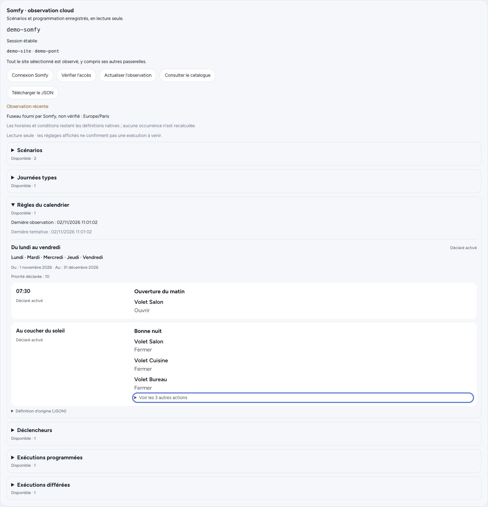

# Somfy cloud observation and saved-scenario launches

The optional cloud source complements the local Overkiz source with saved TaHoma
programmes. By default it only observes definitions. Saved scenarios may be launched through
the separately authorized execution path below; programmes cannot be edited,
deleted, rescheduled or imported as Moli automations. Local device identities and
native command bindings remain unchanged. The global read-only option covers both
sources; cloud scenario consent does not grant native device permissions.

## Protocol evidence and coverage

The public TaHoma Classic client, inspected on 2026-11-01, defines these reads:

| Collection | GET path under `enduserAPI/` | Meaning |
| --- | --- | --- |
| Scenarios | `actionGroups` | Saved action groups, including ordered actions and parameters |
| Calendar days | `setup/calendar/days` | Named day templates, time and dawn/dusk triggers |
| Calendar rules | `setup/calendar/rules` | Calendar-day assignments and recurrence definitions |
| Triggers | `triggers` | Conditional/scheduled programme definitions |
| Scheduled executions | `exec/schedule` | Scheduled execution records returned by the provider |
| Delayed triggers | `exec/delayedTriggerSchedule` | Delayed trigger execution records returned by the provider |

`GET exec/schedule` is a read. The similarly named POST scheduling operations are
not part of this integration. No generic cloud request or action endpoint is
exposed.

These routes are evidenced by the official [Classic bootstrap source](https://classic.tahomalink.com/enduser-mobile-web/steer-html5-client/tahoma/bootstrap.js),
especially its `overkiz/calendar`, `overkiz/trigger`, `overkiz/execution` and
`overkiz/api/action` modules. The retrieved bootstrap has SHA-256
`f8e4b8a50631a51ac22f2c38c4f9e4735f11dcc3f507f835290830b3a0c273ac`.
The accompanying [app configuration](https://classic.tahomalink.com/enduser-mobile-web/steer-html5-client/tahoma-app-configuration.js)
reports version `2025.4.3.W1.8`. Source code was inspected, not executed or bundled.

This is protocol evidence, not proof that every modern TaHoma account or gateway
offers every collection through the newer scoped OAuth session. Availability is
reported separately for each collection. The provider's future execution horizon
and exhaustiveness are not established; an occurrence list is not a complete
evaluation of every recurrence rule. There is no claim of full TaHoma parity.

## Authentication and scope

Authentication follows the independently implemented flow described in
[PyOverkiz's authentication strategy](https://github.com/iMicknl/python-overkiz-api/blob/5f31858570e14be4f58e6cc58b7a448000556449/pyoverkiz/auth/strategies.py):
Somfy Accounts password grant, Ginaite token exchange, BOB site discovery, then a
Ginaite refresh scoped to an explicitly selected setup. The
[published application constants](https://github.com/iMicknl/python-overkiz-api/blob/5f31858570e14be4f58e6cc58b7a448000556449/pyoverkiz/const.py)
are distinct from the user's password and rotating tokens. This interoperability
flow is not a claim of Moli-specific partner registration or provider guarantees. The
derived constants are attributed in [`NOTICE`](../../NOTICE), with the complete
[PyOverkiz MIT licence](../../licenses/pyoverkiz-MIT.txt) from the pinned commit.
That source licence does not establish permission to use Somfy's service with
these application credentials, or imply Somfy endorsement. Acceptance of this
interoperability approach remains a separate maintainer decision.

BOB exposes two different identifiers. The sub-site's `externalOID` identifies the
selected Overkiz setup in the catalogue. Ginaite's OAuth `siteOID` parameter must
instead contain the **parent BOB site's `siteOID`**, stored as the candidate's
`home_id`. The [BOB candidate mapping](https://github.com/iMicknl/python-overkiz-api/blob/5f31858570e14be4f58e6cc58b7a448000556449/pyoverkiz/auth/bob.py#L61)
and [selected-site refresh](https://github.com/iMicknl/python-overkiz-api/blob/5f31858570e14be4f58e6cc58b7a448000556449/pyoverkiz/auth/strategies.py#L411)
establish this distinction; the [reference regression test](https://github.com/iMicknl/python-overkiz-api/blob/5f31858570e14be4f58e6cc58b7a448000556449/tests/test_auth.py#L2053)
uses different parent and sub-site identifiers.

A gateway is selected as a membership anchor; a setup can contain several
gateways. The programme catalogue covers the whole selected setup and is not
filtered to that anchor. Parent-site authentication alone does not establish
membership: the selected gateway must still be returned by the regional API
before programme reads. Unknown country/region mappings require an explicit
supported region.

The provider issues no read-only OAuth scope for this flow. Read-only behaviour
is enforced by the closed Moli transport: fixed HTTPS hosts, authentication POSTs
and the enumerated GETs. The optional saved-scenario POST has its own runtime
read-only fence and per-scenario consent; enabling the cloud source alone never
permits it. Optional metadata reads retain only timezone and
device URL/label mappings; gateway metadata verifies membership. No address,
coordinates or arbitrary setup metadata is published.

Moli must use its own login and rotating session. Never copy Home Assistant's
refresh token: two clients rotating the same token can invalidate each other.
Independent sessions do not exempt clients from provider account quotas.

## Configuration and connection

A cloud-only observer requires neither a local gateway host nor a developer-mode
token. For an isolated test, use a separate data directory and a loopback-only
published port; keep the existing house instance running.

```toml
[[driver]]
id = "tahoma-cloud"
kind = "overkiz"
[driver.options]
read_only = true
[driver.options.cloud]
poll_secs = 1800
```

The `cloud` table enables the optional source. Its polling interval defaults to
1,800 seconds and accepts 300 through 86,400 seconds. Omitting the table leaves
the native source without a cloud task, timer or provider request. A combined
instance adds the same table to its existing local options; the local `host`,
developer token, certificate pin and local polling interval retain their roles.
An instance needs at least one source.

Connect through the owner-only TaHoma page (`#/somfy`), accessible from System. Enter the Somfy
account directly there, then explicitly choose a setup and an anchor gateway.
Do not put credentials in TOML, screenshots, issue comments or chat. The house
owner chooses their own Moli code; a new installation's one-use setup code is
read by the person themselves, following the project's
[installation procedure](../../.claude/skills/installer-moli/SKILL.md).

The username/password request is briefly queued in the encrypted private-state
file and durably consumed before authentication. They are not retained in the
running session or catalogue. The controller owns its cloud session. Before
rotating a refresh token it durably checkpoints the operation in `secrets.enc`;
after rotation it saves the replacement before further authenticated reads.

A typed failure before request dispatch, such as DNS resolution or connection
refusal, can restore the previous session. That rollback must itself be durable
before the token can be tried again. A failed rollback blocks further provider
requests until persistence succeeds. TLS/exchange failures, a global timeout,
an ambiguous HTTP response including a 5xx, or an interrupted refresh checkpoint
do not prove that the token was unused: the possibly consumed token is retired
rather than replayed.

Older version-1 sessions that incorrectly recorded the setup `externalOID` as the
OAuth scope are validated before recovery. Their old access bearer is retired;
a usable replacement refresh is retained for the single writer to checkpoint and
rotate to the parent home. Catalogue identity and the selected gateway stay
unchanged. An interrupted `refreshing` checkpoint or `login_required` session
remains terminal; recovery never replays a possibly consumed refresh token.
After the parent-scoped replacement has been persisted, older binaries that
expect the incorrect setup-scoped binding cannot resume it. Keep the current
vault and master key when rolling back code; never restore an old refresh-token
snapshot, which may contain an already consumed token.

A per-instance operating-system lease permits only one cloud controller to use
an OAuth identity in a vault/data directory. It is acquired on a blocking worker
before restoring a session or consuming an owner request, and remains held until
the actor has actually stopped. At ownership handoff, the session and that
instance's private state are reloaded under the vault lock: pending input and
quota deadlines are current, while observations restart stale. Other instances'
live observations are preserved. This does not coordinate external OAuth clients
or copied data directories. Do not edit cloud-session entries with the CLI while
the controller owns them. The owner API and driver coordinate through a
bounded queue and generation checks. Keep the instance's own master key; never
replace an existing key to repair authentication.

Automatic retries use the provider's advertised `Retry-After`, capped at 3,600
seconds. The cap also applies when restoring a saved delay after restart. Failed
discovery and observation attempts use a growing backoff from 60 to 3,600 seconds
instead of repeating a full discovery every minute. A quota response stops the
current cycle without marking the remaining
unattempted collections as failed observations. Manual refresh does not create a
new login generation or bypass an active quota delay.
A queued connection request encountered during that delay is consumed and
reported as rate-limited, with its request identifier; its password is not left
waiting for an arbitrarily long provider delay.

The owner can disconnect the cloud account even after the `cloud` table has been
removed. Disconnect retires the current lifetime, removes its cloud session,
pending input and cached private data, and prevents an older worker from writing
them back. It neither contacts Somfy nor removes the local developer token,
certificate pin or other instances' data. It is not delayed by a provider quota.

If the private cache is unreadable at startup, disconnect still durably revokes
the credentials and retires the old lifetime. The owner endpoint returns HTTP
503 with `error: "cache_unavailable"` and `credentials_removed: true`, rather
than claiming a complete purge. A cleanup marker (`cloud::CLEANUP_KEY`) keeps the
instance discoverable even after its configuration has been removed. The panel
clears its private browser copy, reports the remaining cleanup and offers an
explicit retry; login and refresh stay blocked while that marker exists.
The shared `private-state.enc` file is preserved: deleting the entire file could
destroy other instances' data. Resolve the storage error, restart Moli if the
cache was unavailable at startup, then retry the scoped cleanup. Its marker is
removed only after the namespace purge is durable. An ordinary error or the
panel's 30-second deadline does not prove credential removal; the panel keeps
the cached view, reports the unknown outcome and does not retry automatically.

## Encrypted private cache and migration

`secrets.enc` contains authentication checkpoints and the opaque lifetime fence.
The catalogue, connection-state cache and bounded pending requests live in the
separate `private-state.enc` file, encrypted with the same master key. Neither
file exposes definitions or credentials through ordinary device state or logs.
The filename is fixed; an instance, setup or provider response cannot choose a
filesystem path.

The controller publishes live observation times in memory. Durable snapshots
neutralize liveness: collection observation timestamps use `Some(0)` where the
catalogue validator requires a timestamp with retained data; the connection's
last-observation timestamp is `None`. Retry metadata needed to resume a bounded
backoff remains durable. A restart therefore restores historical definitions,
not a fresh observation. Unchanged durable content only refreshes memory: it
does not rewrite or synchronize the encrypted snapshot on every poll. Pending
requests still require durable insertion and removal before acknowledgement or
dispatch.

Every session or private-state mutation checks its expected opaque epoch while
holding the vault's transaction lock. Disconnect commits a new epoch and removes
the selected cloud credentials before removing the private namespace. A worker
from the retired lifetime cannot republish data, even if its asynchronous caller
was cancelled while a disk transaction was already running. A rename followed
by a failed directory sync updates the cache to match disk, but is not treated as
durable success; an identical retry must finish the synchronization before it is
acknowledged.

Migration from older versions first writes and synchronizes the encrypted
private copy, then removes the legacy catalogue/state/queue entries from the
vault. It is restartable, preserves newer private records, and does not change
native credentials. These two files are not one atomic transaction: their
generation binding makes an interrupted migration or disconnect safe to resume.
See [backup and restore](../../docs/components/exploitation.md#sauvegarder-et-restaurer)
for the fixed-file backup and old-backup cleanup rules.

## Cached owner interface

Opening the panel or a definition reads the validated cache, without making a
Somfy request. The configured instance, current session generation and selected
setup must match the cached catalogue. A matching last-good observation can
remain visible as stale during a connection failure. A previous account/setup's
catalogue is withheld when that binding no longer matches.

The persisted `Ready` state alone does not establish current freshness: the
cloud source must have completed a cycle in the running process and published
its validated result. A changed durable snapshot must be saved before success;
unchanged definitions can refresh their live timestamps without another disk
write. Each collection retains its own status and observation time. The local
source being online does not make cloud data current.

Detailed definitions are fetched as server-serialized JSON text against the
catalogue's revision. A changed revision requires a new catalogue read instead
of showing a potentially different item at the old index. The interface escapes
this text and exports the original cached response rather than reconstructing
large integers through JavaScript.

Somfy connection passwords and tokens are never returned by this interface.
Opaque programme parameters are intentionally preserved for the owner and can
contain private information of their own.

## Interpreting an inventory

A successful empty array is an observed empty collection. A forbidden,
unsupported, unauthorized, rate-limited, malformed or unavailable response is a
failed observation. It retains the last successful data and observation time;
it does not turn the collection into an empty list.

Unknown bounded objects, action order and typed parameters are retained as
opaque definitions. Moli does not evaluate conditions, infer activation from
undocumented fields, calculate future recurrences or resolve dawn/dusk triggers.
TaHoma calendar wall times remain wall times. Native `utcTime` values remain Unix
milliseconds. A provider timezone is syntactically checked, not certified against
an IANA timezone database.

JSON preservation is semantic, not byte-for-byte source preservation: whitespace,
object-key order and number spelling may change. Integer literals must fit signed
or unsigned 64-bit ranges; larger integers are rejected rather than rounded.
Finite fractional/exponent values follow serde_json's floating-point semantics.
Browser exports must retain the cached API response bytes, avoiding a second
parse/stringify through JavaScript's narrower exact-integer range.

## Readable read-only programmes

The owner view projects known scenario, day and calendar-rule fields into days,
wall times and ordered actions. Exact `target_labels` identify devices, while
referenced days/scenarios resolve only within this catalogue and retain history
qualifications. Integrated days and action groups share the same presentation.
Declared enabled flags at rule, day, trigger and group levels remain separate;
none certifies global agenda activation or a future execution.

Monday is mask bit 1 and Sunday bit 64; months are 1-based. Valid TIME fields are
shown as wall times; DAWN/DUSK remain solar labels, not calculated occurrences.
A daily period is a day cadence. Weekly periods above one, modern solar offsets,
additional solar hours, malformed or partial dates and unknown conditions are
qualified. All-minus-one **bounds** are absent; all-minus-one specific dates are
unknown. Closure percentages are not inverted into opening percentages. Unknown
commands retain their names rather than acquiring guessed semantics.

This is a bounded frontend projection, without dependencies or provider requests merely to display it. It indexes the existing catalogue once and shows up to 50
entries per family, 64 triggers and 100 actions per definition, 16 commands per
action. The first three actions form a preview; the rest render when expanded.
Truncation is explicit and the complete cached JSON remains available unchanged,
including integers outside JavaScript's exact range. The model interprets only
safe, bounded numeric values and never reconstructs the original JSON.

## Bounded private data

Full definitions belong in the encrypted catalogue and owner-only views, not in
ordinary device state, SSE/MCP output or logs. Notification destinations and
parameters can be private even when a scenario label looks harmless. Shared
validation applies to incoming and cached data.

| Limit | Value |
| --- | --- |
| Complete serialized catalogue | 1 MiB |
| Collection response | 512 KiB |
| One raw definition | 64 KiB |
| Raw JSON depth | 24 |
| Raw values plus object keys, across collections | 32,768 |
| Top-level entries, across the six collections | 2,048 |
| UTF-8 string / label / identifier | 8,192 / 256 / 256 bytes |

Overflow rejects the incoming collection without silently truncating it.
Successful updates reserve space for later bounded failure statuses so a network
failure can retain the last good catalogue even near its size limit.

The public fixtures are entirely fabricated; see [fixture provenance](CLOUD-FIXTURES.md).
Synthetic test coverage establishes parser behaviour and safety properties, not
authenticated compatibility or the completeness of a real household inventory.

## Interface demonstration

These screenshots use a fully fabricated setup with two scenarios and one entry
in each other collection. They illustrate the observer-only interface; optional
scenario launch controls are not shown. They do not demonstrate a successful
connection to a real Somfy account. The displayed observation date and all labels,
identifiers and definitions belong to that fixture.




## Optional saved-scenario launches

Global `driver.options.read_only = true` always prevents execution. When the
owner has explicitly enabled control for the integration, each saved scenario
still requires separate consent with a fresh Moli PIN. Revocation remains
available while globally read-only or offline. Consent is encrypted and bound to
the connection generation, selected setup and full scenario definition; reconnecting or
changing that definition requires authorization again. Starting Moli never
replays a launch. Each opaque command value also binds the current catalogue
revision. Revocation can cross a refresh without requiring the old revision;
activation must match the exact current revision.

The owner catalogue exposes a launch capability only when the source is online,
the saved observation is current and the exact Hub point is writable. The UI
uses that opaque capability through the existing Hub command API. Agents and
unauthenticated household callers require human approval; guests cannot see or
launch these multi-device scenarios even after assigning them a shared room.
Every attempt passing the API authorization follows the Hub guard and journal.

The official Classic bootstrap was fetched again without authentication on
**2026-11-04 at 15:37 UTC**: 371,868 bytes, with the same SHA-256 documented above.
Its `executeById` sends POST `exec/{actionGroupOID}` with an empty body and expects
an `execId` string. Moli supports only that saved-id route, never arbitrary action
payloads or scheduling POSTs. This is an observed interoperability interface,
not a published API guarantee.

Before submission Moli rereads gateway membership and the scenario definition.
A missing or changed definition prevents submission. After those reads, the
private lifetime is checked again under the vault lock, including changes made
by another Moli process; the lock is released before network submission. A
completed disconnect during a preparatory read prevents the scenario POST, and
queued consent retains the lifetime captured before its HTTP body was read.
A POST already dispatched before revocation may still execute at Somfy: Moli
does not promise provider-side cancellation. These reads and the POST
are **not atomic at Somfy**; no conditional revision is available. A concurrent
external modification between the read and POST can therefore alter the actions
executed. The acknowledgement means accepted by the provider, not physically
completed. A timeout or ambiguous response is reported as uncertain and never
retried automatically; check TaHoma before manually launching again.

Execution tests use fabricated accounts, definitions and transports only. They do
not establish authenticated provider compatibility or physical completion in a
real home. See the [execution design and tests](../../docs/superpowers/specs/2026-11-04-tahoma-scenario-execution.md).
