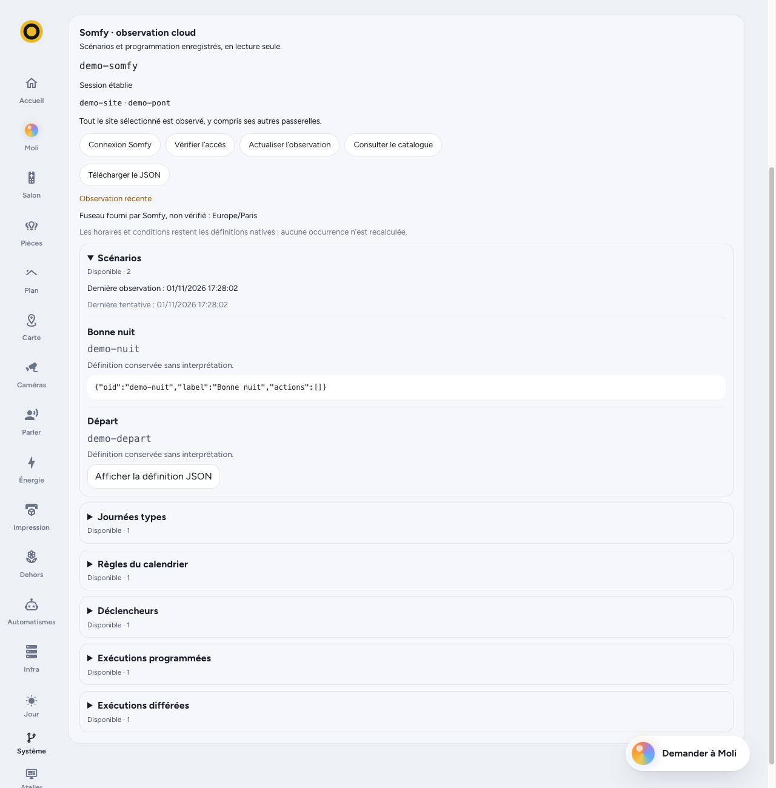
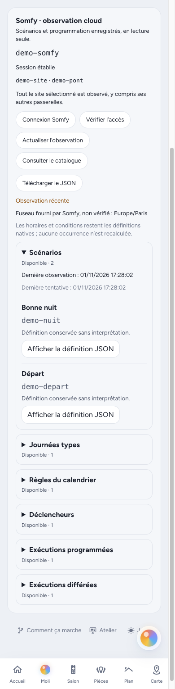

# Somfy cloud programme observation

The optional cloud source complements the local Overkiz source with saved TaHoma
programmes. It observes definitions; it does not execute, activate, edit, delete,
reschedule or import them as Moli automations. Local device identities and local
control policy remain independent.

## Protocol evidence and coverage

The public TaHoma Classic client, inspected on 2026-11-01, defines these reads:

| Collection | GET path under `enduserAPI/` | Meaning |
| --- | --- | --- |
| Scenarios | `actionGroups` | Saved action groups, including ordered actions and parameters |
| Calendar days | `setup/calendar/days` | Named day templates, time and dawn/dusk triggers |
| Calendar rules | `setup/calendar/rules` | Calendar-day assignments and recurrence definitions |
| Triggers | `triggers` | Conditional/scheduled programme definitions |
| Scheduled executions | `exec/schedule` | Scheduled execution records returned by the provider |
| Delayed triggers | `exec/delayedTriggerSchedule` | Delayed trigger execution records returned by the provider |

`GET exec/schedule` is a read. The similarly named POST scheduling operations are
not part of this integration. No generic cloud request or action endpoint is
exposed.

These routes are evidenced by the official [Classic bootstrap source](https://classic.tahomalink.com/enduser-mobile-web/steer-html5-client/tahoma/bootstrap.js),
especially its `overkiz/calendar`, `overkiz/trigger`, `overkiz/execution` and
`overkiz/api/action` modules. The retrieved bootstrap has SHA-256
`f8e4b8a50631a51ac22f2c38c4f9e4735f11dcc3f507f835290830b3a0c273ac`.
The accompanying [app configuration](https://classic.tahomalink.com/enduser-mobile-web/steer-html5-client/tahoma-app-configuration.js)
reports version `2025.4.3.W1.8`. Source code was inspected, not executed or bundled.

This is protocol evidence, not proof that every modern TaHoma account or gateway
offers every collection through the newer scoped OAuth session. Availability is
reported separately for each collection. The provider's future execution horizon
and exhaustiveness are not established; an occurrence list is not a complete
evaluation of every recurrence rule. There is no claim of full TaHoma parity.

## Authentication and scope

Authentication follows the independently implemented flow described in
[PyOverkiz's authentication strategy](https://github.com/iMicknl/python-overkiz-api/blob/5f31858570e14be4f58e6cc58b7a448000556449/pyoverkiz/auth/strategies.py):
Somfy Accounts password grant, Ginaite token exchange, BOB site discovery, then a
Ginaite refresh scoped to an explicitly selected setup. The
[published application constants](https://github.com/iMicknl/python-overkiz-api/blob/5f31858570e14be4f58e6cc58b7a448000556449/pyoverkiz/const.py)
are distinct from the user's password and rotating tokens. This interoperability
flow is not a claim of Moli-specific partner registration or provider guarantees.

BOB exposes two different identifiers. The sub-site's `externalOID` identifies the
selected Overkiz setup in the catalogue. Ginaite's OAuth `siteOID` parameter must
instead contain the **parent BOB site's `siteOID`**, stored as the candidate's
`home_id`. The [BOB candidate mapping](https://github.com/iMicknl/python-overkiz-api/blob/5f31858570e14be4f58e6cc58b7a448000556449/pyoverkiz/auth/bob.py#L61)
and [selected-site refresh](https://github.com/iMicknl/python-overkiz-api/blob/5f31858570e14be4f58e6cc58b7a448000556449/pyoverkiz/auth/strategies.py#L411)
establish this distinction; the [reference regression test](https://github.com/iMicknl/python-overkiz-api/blob/5f31858570e14be4f58e6cc58b7a448000556449/tests/test_auth.py#L2053)
uses different parent and sub-site identifiers.

A gateway is selected as a membership anchor; a setup can contain several
gateways. The programme catalogue covers the whole selected setup and is not
filtered to that anchor. Parent-site authentication alone does not establish
membership: the selected gateway must still be returned by the regional API
before programme reads. Unknown country/region mappings require an explicit
supported region.

The provider issues no read-only OAuth scope for this flow. Read-only behaviour
is enforced by the closed Moli transport: fixed HTTPS hosts, authentication POSTs
and the enumerated GETs only. Optional metadata reads retain only timezone and
device URL/label mappings; gateway metadata verifies membership. No address,
coordinates or arbitrary setup metadata is published.

Moli must use its own login and rotating session. Never copy Home Assistant's
refresh token: two clients rotating the same token can invalidate each other.
Independent sessions do not exempt clients from provider account quotas.

## Configuration and connection

A cloud-only observer requires neither a local gateway host nor a developer-mode
token. For an isolated test, use a separate data directory and a loopback-only
published port; keep the existing house instance running.

```toml
[[driver]]
id = "tahoma-cloud"
kind = "overkiz"
[driver.options]
read_only = true
[driver.options.cloud]
poll_secs = 1800
```

The `cloud` table enables the optional source. Its polling interval defaults to
1,800 seconds and accepts 300 through 86,400 seconds. Omitting the table leaves
the native source without a cloud task, timer or provider request. A combined
instance adds the same table to its existing local options; the local `host`,
developer token, certificate pin and local polling interval retain their roles.
An instance needs at least one source.

Connect through the owner-only Somfy panel on the System page. Enter the Somfy
account directly there, then explicitly choose a setup and an anchor gateway.
Do not put credentials in TOML, screenshots, issue comments or chat. The house
owner chooses their own Moli code; a new installation's one-use setup code is
read by the person themselves, following the project's
[installation procedure](../../.claude/skills/installer-moli/SKILL.md).

The username/password request is briefly queued in the encrypted vault and
consumed before authentication. They are not retained in the running session or
catalogue. The driver is the only writer of its cloud session. Before rotating a
refresh token it checkpoints the operation; after rotation it saves the replacement
before further authenticated reads. An ambiguous refresh response or interrupted
refresh checkpoint requires reconnection instead of replaying an old token.

Older version-1 sessions that incorrectly recorded the setup `externalOID` as the
OAuth scope are validated before recovery. Their old access bearer is retired;
a usable replacement refresh is retained for the single writer to checkpoint and
rotate to the parent home. Catalogue identity and the selected gateway stay
unchanged. An interrupted `refreshing` checkpoint or `login_required` session
remains terminal; recovery never replays a possibly consumed refresh token.
After the parent-scoped replacement has been persisted, older binaries that
expect the incorrect setup-scoped binding cannot resume it. Keep the current
vault and master key when rolling back code; never restore an old refresh-token
snapshot, which may contain an already consumed token.

Use one active writer per vault/data directory. Do not share the observer's vault
between Moli processes or run concurrent CLI secret mutations against it. The
owner API and driver coordinate through the same process and bounded queue.
Keep the new instance's own master key; never replace an existing key to repair
authentication.

Automatic retries respect the provider's advertised `Retry-After`, including
delays longer than an hour. Only the fallback backoff is limited to 60–3,600
seconds. A quota response stops the current cycle without marking the remaining
unattempted collections as failed observations. Manual refresh does not create a
new login generation or bypass an active quota delay.
A queued connection request encountered during that delay is consumed and
reported as rate-limited, with its request identifier; its password is not left
waiting for an arbitrarily long provider delay.

## Cached owner interface

Opening the panel or a definition reads the validated cache, without making a
Somfy request. The configured instance, current session generation and selected
setup must match the cached catalogue. A matching last-good observation can
remain visible as stale during a connection failure. A previous account/setup's
catalogue is withheld when that binding no longer matches.

The persisted `Ready` state alone does not establish current freshness: the
cloud source must have completed a cycle in the running process and persisted
its result. Each collection also retains its own status and observation time.
The local source being online does not make cloud data current.

Detailed definitions are fetched as server-serialized JSON text against the
catalogue's revision. A changed revision requires a new catalogue read instead
of showing a potentially different item at the old index. The interface escapes
this text and exports the original cached response rather than reconstructing
large integers through JavaScript.

Somfy connection passwords and tokens are never returned by this interface.
Opaque programme parameters are intentionally preserved for the owner and can
contain private information of their own.

## Interpreting an inventory

A successful empty array is an observed empty collection. A forbidden,
unsupported, unauthorized, rate-limited, malformed or unavailable response is a
failed observation. It retains the last successful data and observation time;
it does not turn the collection into an empty list.

Unknown bounded objects, action order and typed parameters are retained as
opaque definitions. Moli does not evaluate conditions, infer activation from
undocumented fields, calculate future recurrences or resolve dawn/dusk triggers.
TaHoma calendar wall times remain wall times. Native `utcTime` values remain Unix
milliseconds. A provider timezone is syntactically checked, not certified against
an IANA timezone database.

JSON preservation is semantic, not byte-for-byte source preservation: whitespace,
object-key order and number spelling may change. Integer literals must fit signed
or unsigned 64-bit ranges; larger integers are rejected rather than rounded.
Finite fractional/exponent values follow serde_json's floating-point semantics.
Browser exports must retain the cached API response bytes, avoiding a second
parse/stringify through JavaScript's narrower exact-integer range.

## Bounded private data

Full definitions belong in the encrypted catalogue and owner-only views, not in
ordinary device state, SSE/MCP output or logs. Notification destinations and
parameters can be private even when a scenario label looks harmless. Shared
validation applies to incoming and cached data.

| Limit | Value |
| --- | --- |
| Complete serialized catalogue | 1 MiB |
| Collection response | 512 KiB |
| One raw definition | 64 KiB |
| Raw JSON depth | 24 |
| Raw values plus object keys, across collections | 32,768 |
| Top-level entries, across the six collections | 2,048 |
| UTF-8 string / label / identifier | 8,192 / 256 / 256 bytes |

Overflow rejects the incoming collection without silently truncating it.
Successful updates reserve space for later bounded failure statuses so a network
failure can retain the last good catalogue even near its size limit.

The public fixtures are entirely fabricated; see [fixture provenance](CLOUD-FIXTURES.md).
Synthetic test coverage establishes parser behaviour and safety properties, not
authenticated compatibility or the completeness of a real household inventory.

## Interface demonstration

These screenshots use a fully fabricated setup with two scenarios and one entry
in each other collection. They demonstrate the owner interface, not a successful
connection to a real Somfy account. The displayed observation date and all labels,
identifiers and definitions belong to that fixture.




